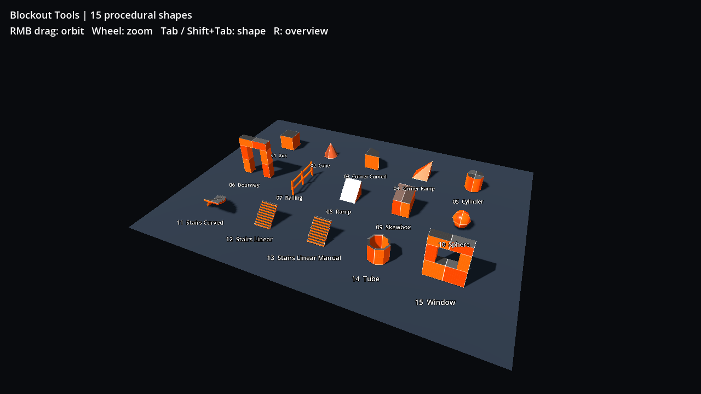

# Godot 3D Blockout Tools

[简体中文](README.md) | English

A native Godot editor plugin for building 3D blockouts with 15 parametric shapes, editable viewport handles, collision and a procedural grid material.

## Install

Copy `addons/blockout_tools` into your Godot project, then enable **Blockout Tools** under **Project Settings → Plugins**. Select a shape in the left dock and click **Add Blockout Shape**. Edit dimensions in the Inspector or drag the shape handles in the 3D viewport.

The development and acceptance target is **Godot 4.7.2**. Other versions have not been validated.

## Demo project

Open `project.godot` and press **F5** for the 15-shape gallery. Right mouse drag orbits, the wheel zooms, Tab / Shift+Tab selects a shape, and R returns to the overview. `demo/my_acceptance.tscn` provides the existing manual test scene.

## Player perspectives

Select **Player** under **Gameplay Nodes** in the dock and click **Add Gameplay Node** to instance the standalone `addons/blockout_tools/nodes/player.tscn` under the current scene root, with undo/redo support. Spawn Point is available; End Point remains a disabled placeholder.

The Player origin is at its feet, with a default camera height of 1.6 m. Adjust **Perspective** (initial first/third person) and **View Height** (camera pivot height above the feet, in metres) in the Player Inspector. Press **Tab** at runtime to switch perspectives without changing the viewing direction. Third person shows a capsule body and places the camera 3 m behind it, with a spring arm that retracts near walls.

Move the Player onto the floor in the editor, then press **F6** to run the current scene: W/S moves forward/backward, A/D strafes, Space jumps, and the mouse turns the view. Esc releases the mouse; left click captures it again. Losing window focus also releases the mouse. Physical keys are read directly, so no Input Map setup is required. Both the scene and controller ship with the addon.

BodyMesh is visible by default in the editor for placement; at runtime it is hidden in first person and shown in third person. With the mouse captured, press **Alt** to toggle noclip flight: W/S flies along the viewing direction, A/D strafes, Space ascends, and Ctrl descends. Flight ignores gravity, walls and floors in either perspective. Turning it off restores the original collision layers/masks, camera obstruction checks and gravity. Esc or loss of window focus pauses flight movement.

## Spawn Point

Select **Spawn Point** under **Gameplay Nodes**, then click **Add Gameplay Node**. Place its foot origin on the floor and rotate around Y. The capsule is 2 m tall with a 0.5 m radius, matching Player clearance; the horizontal arrow points forward (-Z). These green outlines are editor gizmos and do not render during gameplay. Turn off **Enabled** in the Inspector to ignore this point (the gizmo turns grey). Its Area3D collision never blocks the player.

Add a **Player** through Gameplay Nodes and run the scene (F6). At startup, Player uses the first enabled Spawn Point in scene-tree order, including nested scenes, with the correct world position and horizontal heading. Spawn pitch, roll and scale are not applied to Player. If no point is enabled, Player keeps its placed transform. Spawn Point relocates existing Gameplay Players; it does not create extra Players or respawn them when toggled during play.

## Shapes and editing

Box, Cone, Corner Curved, Corner Ramp, Cylinder, Doorway, Railing, Ramp, Skewbox, Sphere, Stairs Curved, Stairs Linear, Stairs Linear Manual, Tube and Window.

- Dimensions use metres and Godot local axes: X width, Y height, forward depth toward −Z.
- Rounded dimensions snap to 0.01 m; disabling Round Size permits finer input.
- Handles on all 15 shapes use the editor’s Use Snap toggle, with a default step of one tenth of the editor translation snap step. Change **Geometry → Grid Snap Ratio** (default 0.1) in the Inspector; each shape saves its own value. Ctrl temporarily toggles snapping and Shift further divides the current step by ten. The grid follows the edited scene root; a plain Node root uses world coordinates. Rotated handles snap to grid planes along their largest movement component. Exact alignment between centimetres preserves other visible dimensions before disabling Round Size; all parameter changes undo/redo together. Window openings retain their wall-thickness and opening limits, which take priority when no grid plane fits inside the allowed range.
- Window handles edit opening width, sill, lintel and opening elevation.
- Undo/redo, parameter-only scene saving, custom materials, collision layers/masks and material defaults are supported.
- Grid lines and checker shading are calculated in the shader. Grid Size sets the major-line spacing: the default 1 m coarse grid contains 0.1 m fine divisions. Minor spacing is always one tenth of Grid Size. No texture files are required. Local and world alignment are supported.

## Implementation

Meshes, normals, UVs and collision points are generated from parameters. The addon does not load a mesh library or external engine resources.

Tube is an annular wall with rectangular cross section. Its Sections parameter controls wall segmentation; a full ring uses at least four convex segments to preserve its opening. Quality 1–4 uses 8, 16, 24 and 32 radial segments for circular primitives.

## Repository layout

- `addons/blockout_tools/`: installable plugin.
- `demo/`: gallery, overview and manual acceptance scene.

Only `addons/blockout_tools/` is needed to install the plugin.

## Acknowledgements

The shape set and workflow are inspired by blockout tools for Unreal Engine 5. This is an independent, native Godot implementation. It contains no code or assets from those tools and is not affiliated with or endorsed by their authors.

## License

[MIT](LICENSE) © 2026 itx130
