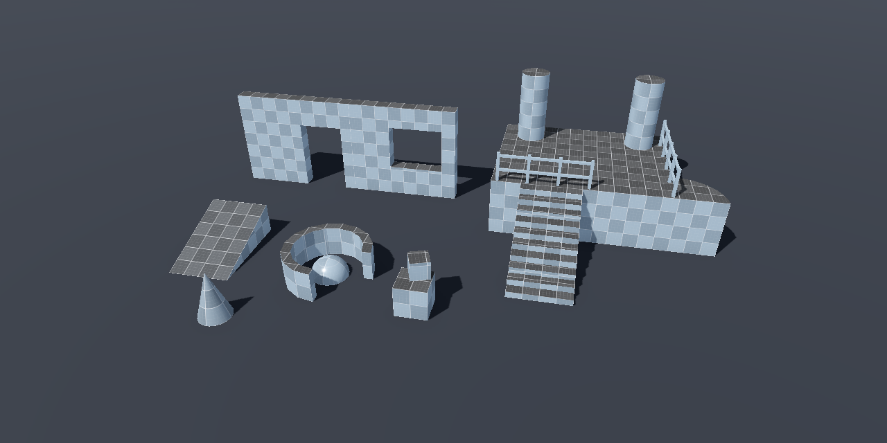
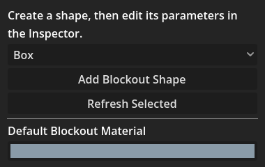
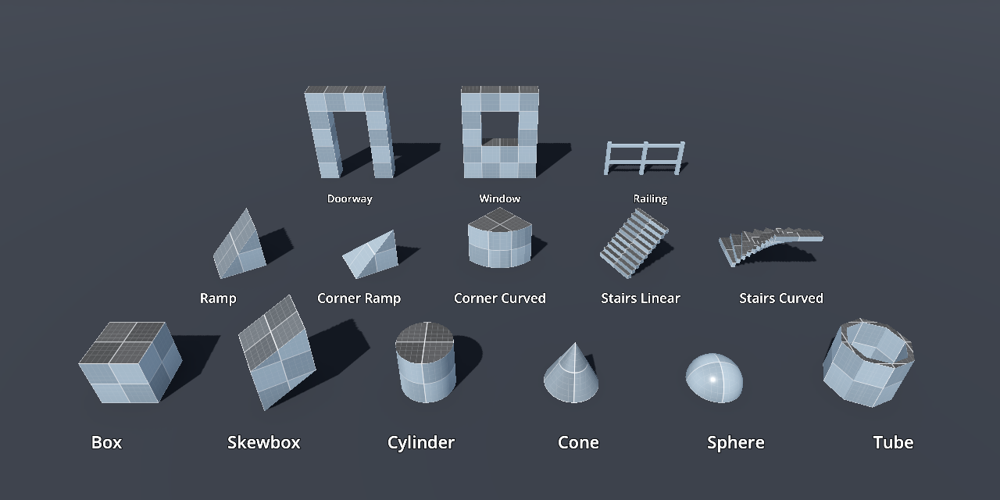
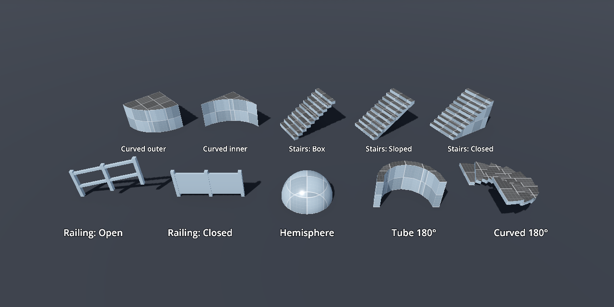
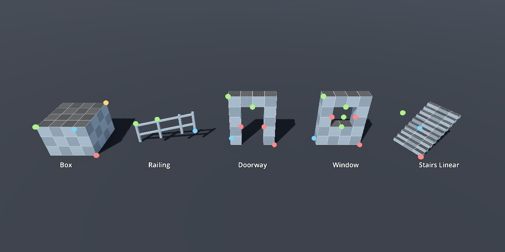
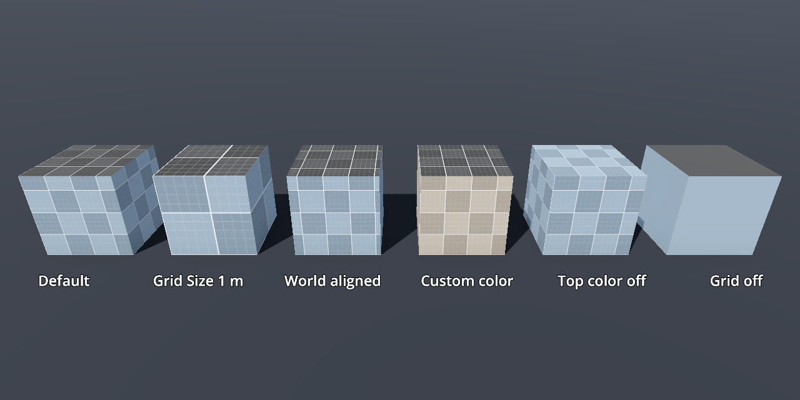

# Godot 3D Blockout Tools

**在 Godot 编辑器里快速搭建 3D 白模（blockout）**

15 种参数化形状 · 视口拖拽手柄 · 网格吸附 · 自动碰撞 · 程序化网格材质

简体中文 | [English](README.en.md)

## ✨ 特性

- 🧱 **15 种参数化形状**：从基础体、坡道楼梯到门洞、窗洞和栏杆，覆盖常见关卡白模需求。
- 🖱️ **视口内直接编辑**：拖拽手柄即可修改尺寸，也可以在检查器中精确输入。
- 📐 **网格吸附**：全部形状手柄跟随编辑器吸附设置，支持 Ctrl 临时切换、Shift 精细吸附。
- 🎨 **程序化网格材质**：网格线和棋盘格都在着色器中计算，无需贴图，支持本地和世界坐标对齐。
- 🧩 **自动碰撞**：根据参数生成凸碰撞体，碰撞层和掩码可配置。
- ↩️ **完整撤销／重做**：场景只保存参数，网格、法线、UV 和碰撞点实时生成。

## 🚀 快速开始

1. 从 [Releases](https://github.com/iTx130/godot3d-blockout-tools/releases) 下载 `blockout_tools-vX.Y.Z.zip` 并解压到项目根目录，或直接将本仓库的 `addons/blockout_tools` 复制到你的项目中。
2. 在 **项目设置 → 插件** 中启用 **Blockout Tools**。
3. 在左侧停靠面板中选择形状，点击 **Add Blockout Shape**。
4. 在 3D 视口中拖拽手柄，或在检查器中修改参数。

> [!NOTE]
> 开发和验收目标版本为 **Godot 4.7.2**，其他版本尚未验证。

## 🧱 形状一览

| 分类 | 形状 |
|---|---|
| 基础体 | Box · Skewbox · Cylinder · Cone · Sphere · Tube |
| 坡道与楼梯 | Ramp · Corner Ramp · Corner Curved · Stairs Linear · Stairs Curved |
| 建筑构件 | Doorway · Window · Railing |

Stairs Linear Manual 暂时从创建列表和检查器形状选项中隐藏，已有节点保持兼容。

多数形状还有样式和开关可选，例如 Corner Curved 的外凸／内凹、楼梯的 Box／Sloped／Closed、栏杆的 Open／Closed 和斜度、半球、任意角度的 Tube 与弧形楼梯：

## 🖱️ 编辑与吸附

编辑器中的手柄位置：红色调 X，绿色调 Y，蓝色调 Z，橙色为 Box 的 X/Z 角点手柄。

- 尺寸单位为米，使用 Godot 本地坐标轴：**X 为宽度，Y 为高度，深度朝向 −Z**。
- 启用 **Round Size** 时尺寸吸附到 0.01 m；关闭后可输入更精细的数值。

| 操作 | 效果 |
|---|---|
| 编辑器“使用吸附”开关 | 控制手柄是否吸附，默认步长与编辑器位移吸附步长一致 |
| **Geometry → Grid Snap Ratio** | 调整吸附步长比例（默认 1.0），每个形状分别保存 |
| 按住 <kbd>Ctrl</kbd> | 临时切换吸附 |
| 按住 <kbd>Shift</kbd> | 将当前步长再缩小十倍 |

<b>吸附细节</b>

网格以当前编辑场景的根节点为基准，普通 Node 根节点使用世界坐标。旋转后的手柄沿移动分量最大的坐标轴对齐网格平面。精确对齐需要非整厘米尺寸时，会保留其他部分的可见尺寸并关闭 Round Size，所有参数变化可一起撤销／重做。Doorway 和 Window 开口保留墙厚和开口范围，范围内没有网格点时优先满足这些约束。

<b>Box：角点手柄</b>

Box 保留原有 X/Y/Z 单轴手柄，并在原点的对顶角 `(X, Y, -Z)` 新增 X/Z 角点手柄。在本地 XZ 平面内自由拖动可同时调整宽度和深度，不锁定比例，保持高度和原点不变；支持网格吸附、厘米舍入及一次取消／撤销／重做。旋转后的角点同时对齐两条独立场景网格坐标，高度与最小尺寸约束优先。

<b>Railing：长度、高度与斜度</b>

- **默认布局**：总长 2 米，由两跨各 1 米组成，柱子位于 0、1、2 米。
- **长度手柄**：位于 −Z 远端。拖动时保留完整 1 米跨，只增减最后一跨；例如 2.4 米长的柱子位于 0、1、2、2.4 米。
- **高度手柄**：位于起点柱顶，调节 Railing Height。默认 1 米高两层横杆，按 0.5 米层距增长且仅顶层随剩余高度移动，最低 0.5 米保留一层。Closed 面板随柱高伸缩。
- **斜度手柄**：位于最靠近长度中点的中间立柱顶端；等距时选靠近起点的一根，没有中间立柱时使用终点柱顶。手柄随对应柱顶移动并可吸附回水平，拖动仍调节整段栏杆的斜度。斜度吸附对齐远端底边，而非中间手柄；正中立柱的手柄移动量为远端升高量的一半，其他位置按实际距离比例移动。
- 手动修改 Railing Sections 或 Railing Section Length 可恢复等距布局；已有场景在拖动前保持原布局。

<b>Doorway 与 Window：开口手柄</b>

Doorway 在门洞左右内侧和顶部增加手柄，可对称调整门洞净宽和净高，保持外框尺寸不变。Window 的控制柄可编辑开口宽度、窗台、过梁和开口高度。

## 🎨 材质与碰撞

- **Grid Size** 设置主网格线间距：默认 0.5 m 主网格内含 0.1 m 细分网格。
- **Grid Subdivisions**（默认 5）控制细分间距，等于 Grid Size / Grid Subdivisions。
- 支持自定义材质、材质默认值、碰撞层／掩码，以及本地和世界坐标对齐。

## 🎮 演示项目

打开 `project.godot` 并按 <kbd>F5</kbd> 运行 15 种形状展示场景。`demo/my_acceptance.tscn` 为手动测试场景。

| 操作 | 效果 |
|---|---|
| 鼠标右键拖拽 | 旋转视角 |
| 滚轮 | 缩放 |
| <kbd>Tab</kbd> / <kbd>Shift</kbd>+<kbd>Tab</kbd> | 切换选中形状 |
| <kbd>R</kbd> | 返回总览 |

## ⚙️ 实现

网格、法线、UV 和碰撞点均由参数实时生成，插件不加载任何网格库或外部引擎资源。

- **Tube** 是矩形截面的环形墙体。Sections 参数控制墙体分段数；完整圆环至少使用四个凸分段以保留中间开口。
- 圆形基础体的 **Quality 1–4** 分别对应 8、16、24、32 个径向分段。

## 📁 仓库结构

| 路径 | 内容 |
|---|---|
| `addons/blockout_tools/` | 可安装的插件本体（安装只需要这个目录） |
| `demo/` | 展示场景、总览场景和手动验收场景 |

## 📄 许可证

[MIT](LICENSE) © 2026 itx130
